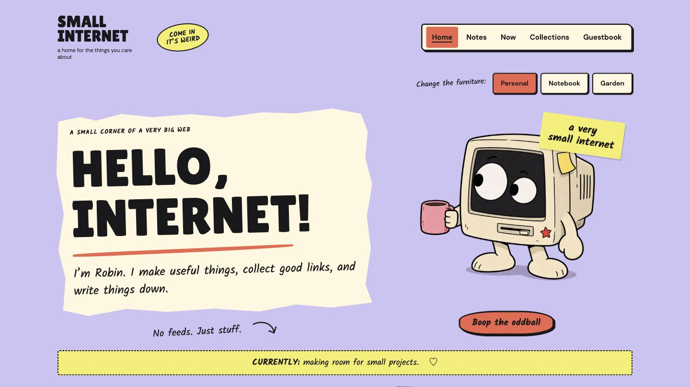

# Small Internet



A free Astro theme for a personal corner of the web: notes, projects, favorite things, and good links. Big comic headings, handwritten details, and a friendly CRT character keep it a little odd. Your writing stays in Markdown; the finished website is static HTML.

Three looks are included, with distinct compositions and artwork:

| Look | What it feels like | Homepage starts with |
| --- | --- | --- |
| **Personal** | Lavender noticeboard, pinned paper, and a CRT companion | Notes |
| **Notebook** | Yellow graph paper, binding, and project folders | Projects |
| **Garden** | Mint paper, growing things, and a plant-and-CRT companion | Links |

Lilita One supplies the comic headings, Kalam the handwritten accents, and DM Sans the readable desktop and phone body text. All fonts are served locally. Transparent comic artwork and responsive variants are included.

The theme includes Markdown archives and detail pages, category filters, a now page, RSS, generated social artwork and favicon, an intentional 404, and a curated guestbook with private browser drafts. It uses Astro 7.3.8 and needs no CMS account or server runtime. Robin and the starter writing are sample content for you to replace.

## Start locally

Use Node.js 22.12.0 or newer and npm. Download or clone the source, open its folder, then run:

```sh
npm ci
npm run dev
```

Open the local address printed by Astro. No hosting banner or public indexing is enabled by default.

| Command | Purpose |
| --- | --- |
| `npm run dev` | Work on the site locally |
| `npm run demo` | Preview the optional banner labeled **Hosting preview** |
| `npm run build` | Generate the static site in `dist/` |
| `npm run preview` | Serve the production build locally |
| `npm run check` | Check types and content |
| `npm run format` | Format editable source |
| `npm run verify` | Run the complete local verification sequence |

Dev, demo, and build automatically regenerate your favicon and social image from the configured identity and default look. You can also run `npm run assets` directly.

`npm run verify` runs type checks, formatting checks, a production build, static output checks, behavior simulations, official-brand checks, and isolated authoring fixtures.

Run `node scripts/verify-behavior.mjs` for code-level simulations of blocked browser storage and keyboard-driven viewport changes. These cover failure branches; they are not a physical keyboard or device test. Inspect the actual site on your target screens as well.

## Make it yours

Start in `src/data/site.ts`: change the site name, owner, intro, tagline, description, footer, current activity, and initial look. `defaultLook` accepts `personal`, `notebook`, or `garden` and sets the initial homepage composition. Visitors can choose a look themselves. Give `storageId` a unique value for your site before launch, then keep it stable on routine updates so visitors retain their look, banner dismissal, and private local guestbook drafts.

| File or folder | What to edit |
| --- | --- |
| `src/data/site.ts` | Identity, introductory copy, default look, and storage namespace |
| `src/data/now.ts` | Current activities and their update date |
| `src/data/garden.ts` | Annotated HTTPS links and categories |
| `src/data/guestbook.ts` | Real, owner-curated messages published with permission |
| `src/content/notes/` | Markdown notes |
| `src/content/projects/` | Markdown projects |
| `src/content/items/` | Markdown collection entries |

`contactUrl` starts empty. Leave it empty until you have a real destination you want to publish. The guestbook starts empty and has no message-sending backend. A visitor's private draft stays in that browser; saving it does not send or publish it.

## Write and organize

Markdown lives in `src/content/notes/`, `src/content/projects/`, and `src/content/items/` (the public collections). The filename becomes the URL slug. Keep filenames simple and update links when renaming them. Each file begins with:

```yaml
---
title: "A title"
description: "A useful one-sentence description: quote text containing colons."
date: 2026-10-08
category: "Making"
featured: false
draft: false
order: 0
---
```

Write Markdown below that header. Title, description, date, and category are required. Featured and draft default to false; order defaults to zero. The homepage prioritizes featured notes and projects, then fills remaining places with other published entries. Notes are ordered by date; projects and collection items by order. Projects and collection items also accept an optional `href` using HTTPS. Notes do not use that field.

Set `draft: true` for unfinished writing; confirm it is absent from the built site before distributing the build. Draft source files still belong to the editable source package, so remove private writing before sharing source. Use local links such as `/notes/your-slug/` and `/collections/your-slug/`.

Nested folders are supported: `src/content/notes/walks/first-walk.md` creates `/notes/walks/first-walk/`. Optional frontmatter `slug: "walks/my-custom-path"` overrides the generated ID and URL. Keep IDs unique within each collection, use simple URL-safe segments, and update links after moving or changing a slug. A slug does not include the `/notes/`, `/projects/`, or `/collections/` prefix. `node scripts/verify-authoring.mjs` builds nested/custom-slug, draft, all-draft, and empty-content fixtures in `output/authoring-fixture/`. It uses installed dependencies and a synthetic public origin to check routes, archives, RSS, and sitemap; it never publishes or edits your original content.

Page structure is in `src/pages/`, reusable pieces in `src/components/` and `src/layouts/`, and visual rules in `src/styles/`. Colors for generated assets are in `scripts/generate-assets.ts`. Keep the font notices in `licenses/` if you redistribute the bundled fonts.

## Build for a real owner

Deploy this theme at a domain root; subdirectory hosting is not supported. First replace sample content, verify the domain you control, and build with its real HTTPS origin:

```sh
SITE_URL=https://your-real-owner-origin PUBLIC_INDEXING=1 npm run build
SITE_URL=https://your-real-owner-origin PUBLIC_INDEXING=1 node scripts/verify-static.mjs
```

The origin above is a placeholder. Use your verified origin without a path, query, credentials, or fragment. Without these settings the site builds with noindex metadata, blocked robots, and an empty sitemap. These crawl controls are not access controls; never put secrets or private records in published static files. Enabling crawlability does not establish indexing or guarantee search/AI recommendations. Check the final host, metadata, social image, links, and crawler responses after publication.

Every look includes the official [Spacefast](https://spacefast.com/) wordmark in the permanent maker footer. That credit travels with the theme and does not claim your site is hosted there.

The optional hosting banner is off by default. Set `SPACEFAST_HOSTED=1` only for a site actually hosted on Spacefast. The fixed banner is dismissible and releases its reserved space immediately; keep its namespaced dismissal key stable. `npm run demo` enables the explicitly labeled hosting preview locally.

## Optional Spacefast setup

The [official Astro hosting recipe](https://spacefast.com/docs/recipes/astro/) describes static output publishing. Once you've reviewed your build and chosen to publish, inspect the plan first:

```sh
sf publish ./dist --prebuilt --dry-run
```

Then, if the plan matches your intended destination, `sf publish ./dist --prebuilt` uploads the build. Publishing can create or update an external Space; running this theme locally never does that. No account or deployment binding is included. Configure the correct owner origin and hosting flag for the actual build, then check the hosted pages and crawler responses.

## Editable source package

`node scripts/package.mjs` stages a clean editable copy in `output/clean-source/`. After reviewing the source you intend to share, `node scripts/package.mjs --zip` creates `output/small-internet-1.0.0.zip`. This requires a system `zip` utility. The allowlist includes source, public assets, lockfile, config, license notices, the asset/package/demo/verification scripts, formatter settings, and CI workflow. It excludes dependencies, builds, environment files, deployment state, internal reports, mockups, screenshots, history, and local visitor data.

The package includes your content files and curated guestbook source. Review those before redistribution; the packaging script cannot decide whether your edits contain personal information. Verify your customized copy with the included commands and inspect the production build on your target screens.

## License

The [MIT license](LICENSE) covers theme code, starter writing, and generated comic artwork. Fonts retain their SIL Open Font License terms, and the official Spacefast wordmark remains a separate trademark asset. See [third-party notices](THIRD-PARTY-NOTICES.md) and the included `licenses/` files.
